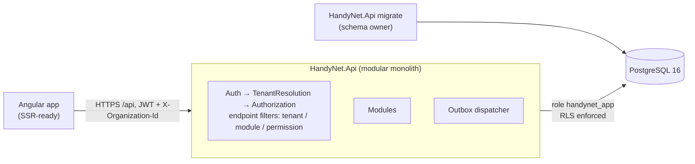
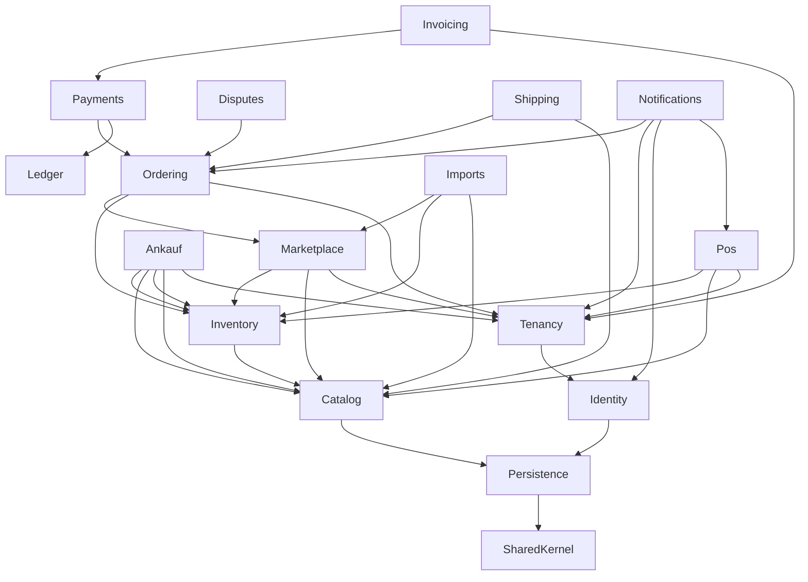

# Architecture

See the ADRs in [`docs/adr`](adr/) for the reasoning. This page is the map.

## Runtime

## Module dependency map (implemented slice)

Arrows point from a module to what it may depend on. Enforced by project references and
`tests/HandyNet.ArchitectureTests`.

| Module | Schema | Owns | Public contract |
|---|---|---|---|
| Identity | `identity` | users, password hashing, lockout, JWT access tokens (disabled accounts / revoked admin role rejected per request), rotating refresh tokens (sessions, reuse detection), password reset and email verification tokens (ADR-0010); platform administration of user accounts (`/api/admin/users`, ADR-0013) | `IUserAccounts`, events `EmailVerificationRequested` / `PasswordResetRequested`; port `IUserMembershipSource` (implemented by Tenancy) |
| Tenancy | `tenancy` | organizations (master data incl. tax number and contact data), verification, status history, memberships/roles (incl. per-cashier POS rights on staff memberships; at least one owner, DB-enforced), module activation, tenant resolution; platform administration of companies (`/api/admin/organizations`, ADR-0013) | `IOrganizationDirectory`, `IOrganizationModuleDirectory` (admin: organizations with a module); port `IOrganizationFactSource` (admin counts, implemented by POS and Marketplace) |
| Catalog | `catalog` | canonical products, EAN/MPN identity, matching rules, lookup, canonical product images (upload by creating org or platform admin, SkiaSharp re-encoding, public immutable serving — ADR-0011) | `IProductCatalog`, `ProductMatcher` |
| Inventory | `inventory` | warehouses, stock levels, movements (receipts with EK), reservations, serialized units (IMEI, Luhn rule), sell/return staging for POS | `IInventory` |
| Marketplace | `marketplace` | supplier offers, B2B listing view (with model data + images), filters, facets, offer detail with other sellers; read-only for products (no product creation); platform moderation (offer and seller blocks, separate from the seller's status, audited; `/api/admin/marketplace`) | `IOfferReservations` (incl. `GetBlockedAsync` → `offer.blocked`), `IOfferSync`, `IOwnOfferPrices` |
| Imports | `imports` | CSV/XLSX parsing, mapping, preview (dry run), commit; manual single-item Lager entry (`/api/inventory/items`, same apply path as a one-row import, idempotent) | – (top-level) |
| Ordering | `ordering` | B2B orders, idempotency, lifecycle incl. delivery + inspection window, completion job | `IOrderFulfilment` |
| Shipping | `shipping` | shipments, carrier adapters (Manual, Simulated), labels, tracking events, parcel/insurance/lithium rules, tracking sync job | – (top-level; uses `IOrderFulfilment`) |
| Payments | `payments` | payments via PSP adapter (Simulated today), webhooks (status re-fetched), commission, refunds, payouts after completion | `ICommissionStatements` (commission per payment, for invoicing) |
| Invoicing | `invoicing` | monthly commission invoices to sellers, corrections (Rechnungskorrektur) for later refunds, gapless platform-wide numbers per series and year (DB-enforced), immutable documents, German PDF, monthly job + admin issuing (ADR-0009) | – (top-level; uses `ICommissionStatements`, `IOrganizationDirectory`) |
| Disputes | `disputes` | buyer complaints within the inspection window, message thread, seller refund / buyer withdrawal / escalation, platform decision | – (top-level; uses `IOrderFulfilment`) |
| Ankauf | `ankauf` | monthly buyback price lists (XLSX), approval rules, immutable price versions, versioned condition policy, dealer quotes, device intake (IMEI stock with §25a purchase price), Ankaufbeleg (PDF), seller-data retention job (anonymization, ADR-0009) | – (top-level; uses `IProductCatalog`, `IInventory`, `IOrganizationDirectory`) |
| POS | `pos` | registers (gapless receipt numbers), cash sessions + daily closing (Z-report, denomination counts), immutable receipts with Storno/returns, line notes and customer snapshot, reprints, §25a margin VAT, POS prices, customer master, product grid read model (`pos.sellable_stock` view), sales reports, POS PINs + cashier switching + manager approvals, e-receipts (email event, public QR link), invoices for POS sales (gapless per organization), cash rounding, fiscal layer (ADR-0012: mode per organization/register, simulated test TSE, fiskaly adapter, outages, DSFinV-K export) | event `ReceiptEmailRequested` (consumed by Notifications); port `IOfferPriceSource` (fallback price; the host composes it from Marketplace `IOwnOfferPrices`, since POS must not depend on Marketplace) – top-level; uses `IInventory`, `IProductCatalog`, `IOrganizationDirectory` |
| Ledger | `ledger` | immutable double-entry journal; single write path `ledger.post_entry`; tenant-visible own accounts | `ILedger` |
| Notifications | `notifications` | email queue fed by outbox events (order placed/status changed, organization verified, email verification, password reset — de/en; POS e-receipts as text + HTML), SMTP delivery with retry, account email bodies redacted after delivery | – (consumes events only) |
| Persistence | `infra` | DbContext, RLS session interceptor, audit log, outbox | `IModuleModel` |

### Planned modules and where they attach

| Planned module | Depends on |
|---|---|
| Repairs | Catalog, Inventory (parts consumption), Ordering (parts orders), Shipping |
| Certified fiscal operation (fiskaly verified in the sandbox, full DSFinV-K) | POS (`IFiscalSigner`, ADR-0012) |
| Accounting exports (XRechnung/ZUGFeRD e-invoices, DATEV) | Invoicing, Payments, POS |
| Returns & Warranty (return shipments, restocking, partial refunds) | Disputes, Shipping, Inventory, Payments |
| B2C Marketplace | Catalog, Marketplace (separate B2C visibility), Payments |

## Shared infrastructure

- `HandyNet.FileStorage`: `IFileStorage` (interface in SharedKernel) with `Local` (disk) and `S3` (S3-compatible)
  providers, selected by `FileStorage:Provider` (ADR-0011). Used by Catalog for product images.

## Request pipeline

1. JWT bearer authentication (`sub`, `hn_admin` claims); `AccountStatusCheck` rejects tokens of disabled accounts and stale `hn_admin` claims (ADR-0013).
2. `TenantResolutionMiddleware`: if `X-Organization-Id` is present, verify membership in the DB, load status,
   role and modules into `TenantContext`.
3. Endpoint filters: `RequireTenant` → `RequireModule` (verified + enabled) → `RequirePermission`.
4. EF `TenantSessionInterceptor` sets `app.current_org` on every connection; RLS does the rest.
5. `SaveChanges` interceptors write the audit log and the outbox in the same transaction.

## Errors

RFC 7807 problem details with a stable machine-readable `code` (`order.insufficient_stock`,
`module.disabled`, …). 422 = validation, 409 = conflict/state, 403 = tenant/module/permission, 404 = not found
(also used for other tenants' resources, so existence is not revealed).
