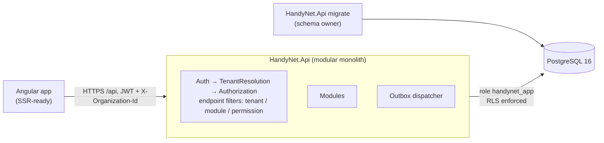
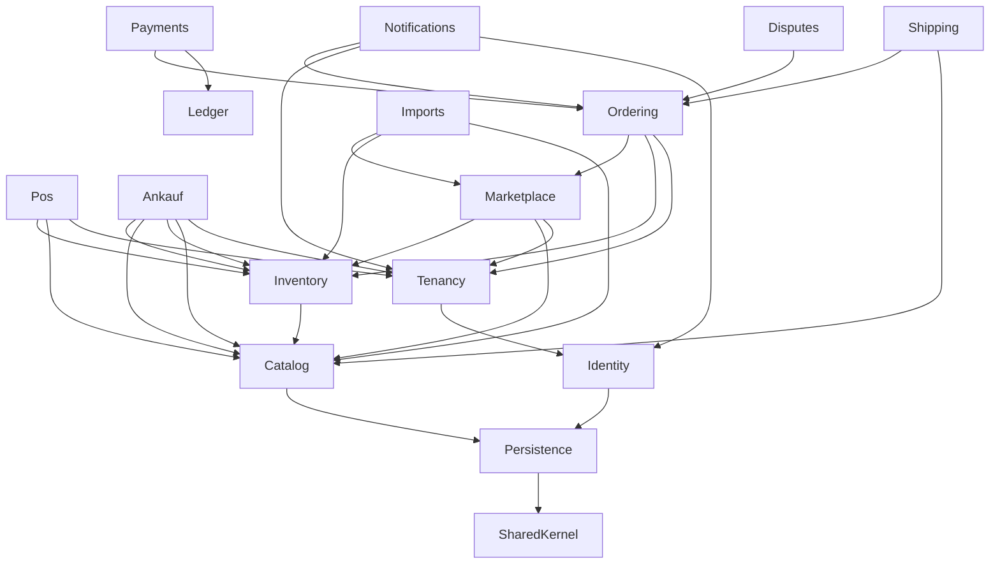

# Architecture

See the ADRs in [`docs/adr`](adr/) for the reasoning. This page is the map.

## Runtime

## Module dependency map (implemented slice)

Arrows point from a module to what it may depend on. Enforced by project references and
`tests/HandyNet.ArchitectureTests`.

| Module | Schema | Owns | Public contract |
|---|---|---|---|
| Identity | `identity` | users, password hashing, lockout, JWT | `IUserAccounts` |
| Tenancy | `tenancy` | organizations, verification, memberships/roles, module activation, tenant resolution | `IOrganizationDirectory` |
| Catalog | `catalog` | canonical products, EAN/MPN identity, matching rules | `IProductCatalog`, `ProductMatcher` |
| Inventory | `inventory` | warehouses, stock levels, movements, reservations, serialized units (IMEI), sell/return staging for POS | `IInventory` |
| Marketplace | `marketplace` | supplier offers, B2B listing view, reservation function | `IOfferReservations`, `IOfferSync` |
| Imports | `imports` | CSV/XLSX parsing, mapping, preview (dry run), commit | – (top-level) |
| Ordering | `ordering` | B2B orders, idempotency, lifecycle incl. delivery + inspection window, completion job | `IOrderFulfilment` |
| Shipping | `shipping` | shipments, carrier adapters (Manual, Simulated), labels, tracking events, parcel/insurance/lithium rules, tracking sync job | – (top-level; uses `IOrderFulfilment`) |
| Payments | `payments` | payments via PSP adapter (Simulated today), webhooks (status re-fetched), commission, refunds, payouts after completion | – (top-level) |
| Disputes | `disputes` | buyer complaints within the inspection window, message thread, seller refund / buyer withdrawal / escalation, platform decision | – (top-level; uses `IOrderFulfilment`) |
| Ankauf | `ankauf` | monthly buyback price lists (XLSX), approval rules, immutable price versions, versioned condition policy, dealer quotes, device intake (IMEI stock with §25a purchase price), Ankaufbeleg (PDF) | – (top-level; uses `IProductCatalog`, `IInventory`, `IOrganizationDirectory`) |
| POS | `pos` | registers (gapless receipt numbers), cash sessions + daily closing (Z-report), immutable receipts with Storno/returns, §25a margin VAT, fiscal signer abstraction (test signer only, ADR-0008) | – (top-level; uses `IInventory`, `IProductCatalog`, `IOrganizationDirectory`) |
| Ledger | `ledger` | immutable double-entry journal; single write path `ledger.post_entry`; tenant-visible own accounts | `ILedger` |
| Notifications | `notifications` | email queue fed by outbox events (order placed/status changed, organization verified), SMTP delivery with retry | – (consumes events only) |
| Persistence | `infra` | DbContext, RLS session interceptor, audit log, outbox | `IModuleModel` |

### Planned modules and where they attach

| Planned module | Depends on |
|---|---|
| Repairs | Catalog, Inventory (parts consumption), Ordering (parts orders), Shipping |
| Fiscal adapter (fiskaly TSE) + DSFinV-K export | POS (`IFiscalSigner`) |
| Invoicing & Accounting | Ordering, Payments, POS (XRechnung/ZUGFeRD, DATEV export) |
| Returns & Warranty (return shipments, restocking, partial refunds) | Disputes, Shipping, Inventory, Payments |
| B2C Marketplace | Catalog, Marketplace (separate B2C visibility), Payments |

## Request pipeline

1. JWT bearer authentication (`sub`, `hn_admin` claims).
2. `TenantResolutionMiddleware`: if `X-Organization-Id` is present, verify membership in the DB, load status,
   role and modules into `TenantContext`.
3. Endpoint filters: `RequireTenant` → `RequireModule` (verified + enabled) → `RequirePermission`.
4. EF `TenantSessionInterceptor` sets `app.current_org` on every connection; RLS does the rest.
5. `SaveChanges` interceptors write the audit log and the outbox in the same transaction.

## Errors

RFC 7807 problem details with a stable machine-readable `code` (`order.insufficient_stock`,
`module.disabled`, …). 422 = validation, 409 = conflict/state, 403 = tenant/module/permission, 404 = not found
(also used for other tenants' resources, so existence is not revealed).
