# Data model — first vertical slice

PostgreSQL 16, snake_case, one schema per module. Money = `bigint` cents. Enums = `varchar` text.
Optimistic concurrency uses PostgreSQL `xmin`. RLS column in **bold**.

```mermaid
erDiagram
    USERS ||--o{ MEMBERSHIPS : has
    ORGANIZATIONS ||--o{ MEMBERSHIPS : has
    ORGANIZATIONS ||--o{ ORGANIZATION_MODULES : enables
    ORGANIZATIONS ||--o{ WAREHOUSES : owns
    WAREHOUSES ||--o{ STOCK_LEVELS : holds
    PRODUCTS ||--o{ STOCK_LEVELS : of
    STOCK_LEVELS ||..o{ STOCK_MOVEMENTS : "history"
    STOCK_LEVELS ||..o{ STOCK_RESERVATIONS : "reserved by"
    PRODUCTS ||--o{ OFFERS : "offered as"
    WAREHOUSES ||--o{ OFFERS : "ships from"
    ORGANIZATIONS ||--o{ OFFERS : sells
    ORGANIZATIONS ||--o{ IMPORT_BATCHES : uploads
    IMPORT_BATCHES ||--o{ IMPORT_ROWS : contains
    ORDERS ||--o{ ORDER_LINES : contains
    OFFERS ||--o{ ORDER_LINES : "ordered via"
    STOCK_RESERVATIONS ||--o| ORDER_LINES : backs
```

| Table | Key columns | Constraints / notes |
|---|---|---|
| `identity.users` | id, email, password_hash, is_platform_admin, is_active, disabled_at, disabled_reason, failed_login_count, locked_until, email_verified_at, verification_email_requested_at, password_reset_requested_at | unique email; enabled ⇒ no disabled_at/reason (check); at least one active platform admin (deferred trigger `platform_admin_required`, ADR-0013) |
| `identity.refresh_tokens` | id, user_id, family_id, token_hash (SHA-256 hex), expires_at, used_at, replaced_by_id, revoked_at, revocation_reason | unique token_hash; unique replaced_by_id; used ⇔ replaced, revoked ⇔ reason (checks); xmin concurrency; no DELETE grant (ADR-0010) |
| `identity.account_tokens` | id, user_id, purpose (EmailVerification/PasswordReset), token_hash, expires_at, used_at, revoked_at | unique token_hash; not both used and revoked; xmin concurrency; no DELETE grant |
| `tenancy.organizations` | id, name, legal_name, vat_id, tax_number, address, contact_email, contact_phone, website, is_wholesaler/is_retailer/is_repair_provider, status, status_reason | unique vat_id; at least one capability; xmin concurrency (admin edit) |
| `tenancy.organization_status_changes` | id, organization_id, kind (StatusChange / LegalDetailsChanged), from_status (null = registration), to_status, reason, changed_by, changed_at | append-only (no UPDATE/DELETE grant); platform data, not tenant-owned (ADR-0013); backfilled from the audit log; LegalDetailsChanged ⇒ from = to (check, ADR-0014) |
| `tenancy.organizations` (added, ADR-0014) | receipt_header (≤ 500), receipt_footer (≤ 1000), bank_name, iban, bic, managing_director, register_court, register_number, payment_terms_days | IBAN/BIC shape, bank data needs an IBAN, payment terms 0–365 (checks; IBAN checksum in the domain); RLS: read all, insert open, UPDATE only without tenant or for the own row, no DELETE policy |
| `tenancy.organization_logos` | id (UUIDv4 = public token), **organization_id**, screen_storage_key/width/height/size (PNG ≤ 480 px), print_storage_key/width/height/size (JPEG ≤ 1200 px), sha256, original_format/size, uploaded_by/at, removed_at/by | one active logo per organization (partial unique index); removed ⇔ removed_by (check); only the one-time removal may change a row (trigger); RLS: read all, insert/update own organization; no DELETE grant |
| `tenancy.memberships` | organization_id, user_id, role, pos_permissions text[] (staff only), pos_max_discount_percent (staff only) | unique (org, user); POS rights only on Staff rows (check); discount 0–100 (check); every organization keeps an owner (deferred trigger `owner_required`); no DELETE grant — removal only via `tenancy.admin_remove_membership` (platform admin, audited) |
| `tenancy.organization_modules` | (organization_id, module), enabled_by, enabled_at | removal is the only app-level DELETE |
| `catalog.products` | id, brand(_key), name, category, quality, mpn(_key), ean, model_name, compatible_models text[], model_keys text[] (normalized model + compatible models), created_by_organization_id | unique ean; unique (brand_key, mpn_key, quality); EAN or MPN required; indexes on brand, quality, GIN(model_keys) |
| `catalog.product_images` | id, product_id, position (0 = primary, null = removed), storage_key, thumbnail_storage_key, content_type (WebP), width/height, sizes, sha256, original_format/size, uploaded_by_organization_id (null = platform admin), uploaded_by_user_id, removed_at/by | canonical (not tenant-owned); ≤ 8 active (CHECK position < 8); DEFERRABLE unique (product_id, position); removed ⇔ no position; RLS: read all, insert/update only by the product's creating org or without tenant; no DELETE grant (ADR-0011) |
| `inventory.warehouses` | id, **organization_id**, code, is_default | unique (org, code); one default per org; AK (org, id) |
| `inventory.stock_levels` | **organization_id**, warehouse_id, product_id, on_hand, reserved | FK (org, warehouse) → cannot point at another tenant's warehouse; `0 ≤ reserved ≤ on_hand` |
| `inventory.stock_movements` | id identity, **organization_id**, quantity (≠0), on_hand_after, type, reference, unit_cost_minor (EK per unit for receipts, nullable) | append-only (no UPDATE/DELETE grant); unit_cost ≥ 0 |
| `inventory.stock_reservations` | id, **organization_id** (stock owner), reserved_by_organization_id, quantity, status, reference | created/released only via DB functions |
| `marketplace.offers` | id, **organization_id**, product_id, warehouse_id, supplier_sku(_key), price_minor, min_order_quantity, delivery_days, condition, status | unique (org, sku_key); price > 0 |
| `marketplace.offer_listings` (view) | published offers of verified B2B sellers + available stock + model_name, compatible_models, model_keys, image_count, primary_image_id | visible only with a tenant; offers indexed on (status, price_minor) and (status, delivery_days) |
| `imports.import_batches` | id, **organization_id**, file_sha256, format, headers, mapping jsonb, summary jsonb, status | history kept; duplicate files detected by hash |
| `imports.import_rows` | **organization_id**, batch_id, row_number, raw jsonb, parsed fields, status, messages, planned actions, old price/qty | |
| `imports.manual_entries` | id, **organization_id**, idempotency_key, request_hash, product_id, product_action, warehouse_id, quantity_received, unit_ids uuid[], unit_cost_minor, offer_id, offer_action, created_by/at, result jsonb (response replayed for retries) | unique (org, idempotency_key); insert-only (no UPDATE/DELETE grant); RLS; unit_ids empty or = quantity |
| `ordering.orders` | id, number (sequence), **buyer/seller_organization_id**, status, net/vat/gross minor, idempotency_key, request_hash, shipped/delivered/completed_at, inspection_ends_at | unique (buyer, idempotency_key); buyer ≠ seller; gross = net + vat |
| `ordering.order_lines` | order_id, line_number, offer_id, product snapshot, quantity, unit_price_minor, line_net_minor, reservation_id | line_net = unit × qty; RLS via parent order |
| `shipping.shipments` | id, order_id, **seller/buyer_organization_id**, carrier, status, tracking_number, parcel, declared_value_minor, insured, contains_lithium_batteries, label_pdf, handed_over_at, delivered_at | unique (carrier, tracking_number); RLS: both parties read, seller writes |
| `shipping.tracking_events` | shipment_id, external_id, occurred_at, kind, description | unique (shipment, external_id); append-only (no UPDATE grant) |
| `payments.payments` | id, order_id, **buyer/seller_organization_id**, provider, provider_payment_id, amount_minor, commission_net/vat_minor, status, paid_at, refunded_at | one live (Open/Paid) payment per order; unique provider id; RLS: buyer inserts, seller updates, both read |
| `payments.payouts` | id, payment_id (unique), **seller_organization_id**, amount_minor, provider_transfer_id | one payout per payment |
| `disputes.disputes` | id, order_id, **buyer/seller_organization_id**, reason, status, escalated/resolved_at, resolved_by, resolution | one active dispute per order; RLS: buyer opens, both read/update |
| `disputes.dispute_messages` | dispute_id, from, user_id, text, sent_at | append-only; RLS via dispute |
| `inventory.stock_units` | **organization_id**, warehouse, product, imei (15), status, tax_scheme, purchase_price_minor, source | unique IMEI among InStock/Reserved platform-wide; RLS |
| `ankauf.intakes` | **organization_id**, quote_id, imei, seller jsonb (personal data), status, inspection findings, inspected offer, paid, payment method, stock_unit_id, anonymized_at | one live intake per quote; RLS; update trigger: identity columns fixed, seller changes only by one-way anonymization, closed intakes change only by anonymization; anonymized ⇒ seller = fixed placeholder (check); no DELETE; seller never copied to the audit log |
| `invoicing.number_sequences` | (kind, year), next_number | platform-wide counter per series (Invoice / CreditNote) and year; starts at 1, +1 only (trigger); deferred trigger: every allocated number has its document at commit; no DELETE |
| `invoicing.invoices` | id, **organization_id** (seller = recipient), kind, number, number_year, sequence_number, billing_month, service period, issue_date, issued_at, referenced_invoice_id/number/date, vat_rate, total net/vat/gross minor, issuer jsonb, recipient jsonb | unique number and (kind, year, sequence); number = prefix + year + 6-digit sequence (check); must carry the number just allocated; one invoice per (seller, month), one credit note per (invoice, refund month); invoice > 0, credit note < 0 with reference to an invoice of the same seller; totals = sum of lines (deferred trigger); immutable (no UPDATE/DELETE grant + trigger); RLS |
| `invoicing.invoice_lines` | (invoice_id, line_number), **organization_id**, kind, payment_id, order_id, order_number, paid_at, net/vat/gross minor, credited_invoice_id/line_number | gross = net + vat; unique (payment_id, kind) → invoiced once, credited once; kind/organization match the document; credit line exactly negates the referenced invoice line (trigger); immutable; RLS |
| `ankauf.price_lists` / `price_list_entries` | list: label, validity, status, skipped rows; entry: model key, price, previous price, change, decision | platform data (admin only); one entry per model per list |
| `ankauf.price_versions` | model key, price_minor (Gut), valid_from/until, price_list_id | immutable (trigger) |
| `ankauf.condition_policies` | number, settings jsonb, effective_from | immutable; version 1 seeded |
| `ankauf.quotes` | **organization_id**, model, price_version_id, policy id, condition, defects, battery, IMEI, all computed amounts, valid_until | immutable; RLS per dealer |
| `ledger.accounts` / `journal_entries` / `postings` | account per (organization?, type, currency); entry with idempotency_key; postings amount_minor ≠ 0 | written only via `ledger.post_entry`; immutable (triggers); balanced per entry |
| `notifications.email_messages` | id, source_id (outbox message), template, recipient, subject, body, status, attempts, next_attempt_at | unique (source_id, recipient) → at-least-once events never send twice; no DELETE grant |
| `infra.audit_log` | occurred_at, user_id, organization_id, entity_type, entity_id, action, changes jsonb | append-only |
| `infra.outbox_messages` | id, type, payload jsonb, occurred_at, processed_at, attempts | partial index on unprocessed |
| `pos.registers` | id, **organization_id**, name, warehouse_id, next_receipt_number, is_active | unique (org, name); FK (org, warehouse); counter only moves by +1 (trigger); deferred trigger: every allocated number has its receipt at commit; no DELETE |
| `pos.cash_sessions` | id, **organization_id**, register_id, status, opening/expected/counted cash, difference, summary jsonb (Z-report), opening/closing_denominations jsonb (value_minor × count, optional), opened/closed at/by | one open session per register (partial unique index); closed ⇒ figures present and difference = counted − expected; closed rows immutable (trigger); opening cash/denominations/opened at/by never change (trigger) |
| `pos.cash_movements` | id, **organization_id**, session_id, kind (Deposit/Withdrawal), amount_minor > 0, reason, reason_code (predefined, nullable) | insert-only; needs an open session (trigger); immutable |
| `pos.receipts` | id, **organization_id**, register_id, session_id, warehouse_id, number, kind (Sale/Storno/Return), referenced_receipt_id, customer_id (nullable), idempotency_key, request_hash, total gross/net/vat, change, reason, fiscal_* (nullable), document jsonb (incl. customer snapshot and line notes) | unique (register, number); unique (org, idempotency_key); one Storno per sale; Sale > 0, Storno/Return ≤ 0 with reference; FK (org, customer); number must be the one just allocated and the session open (insert trigger); immutable (no UPDATE/DELETE grant + trigger) |
| `pos.receipt_lines` | (receipt_id, line_number), **organization_id**, product_id, stock_unit_id, imei, description, note (≤ 200), quantity (signed), unit_price, discount, line_gross, tax_treatment, vat_rate, vat, net, purchase_price (§25a), original_line_number | line_gross = unit × qty − discount; net + vat = line_gross; §25a needs unit + purchase price; immutable |
| `pos.receipt_payments` | (receipt_id, method), **organization_id**, amount_minor (signed), tendered_minor | amount ≠ 0; tendered ≥ amount; immutable |
| `pos.receipt_reprints` | id, **organization_id**, receipt_id, sequence, printed_at/by | unique (receipt, sequence), sequence ≥ 1; FK (org, receipt); append-only (no UPDATE/DELETE grant + trigger); RLS |
| `pos.prices` | (**organization_id**, product_id), price_minor (gross, nullable = cleared), updated_at/by, xmin | price > 0 when set; no DELETE grant; RLS; changes in the audit log |
| `pos.customers` | id, **organization_id**, name, company, email, phone, street, postal_code, city, country_code, vat_id, created/updated | AK (org, id); no DELETE grant; RLS; all identifying fields `[PersonalData]` → never copied into the audit log |
| `pos.cashier_pins` | (**organization_id**, user_id), pin_hash (PBKDF2-SHA256, nullable = cleared), failed_attempts (0–5), locked_until, updated_at/by, xmin | RLS; no DELETE (grant + trigger); pin_hash `[PersonalData]` (never in the audit log); 5 wrong PINs lock 15 min; a new PIN lifts the lock (ADR-0008 "Staff") |
| `pos.cashier_sessions` | id, **organization_id**, register_id, cashier_user_id, device_user_id, token_hash (SHA-256, unique), created/expires/last_seen_at, ended_at, ended_reason (Locked/Replaced) | RLS; FK (org, register); identity columns fixed and an ended session final (trigger); no DELETE |
| `pos.approvals` | id, **organization_id**, register_id, permissions text[], approver_user_id, requested_by_user_id, device_user_id, token_hash (unique), created/expires_at, used_at, used_for, receipt_id / cash_movement_id / session_id | RLS; ≥ 1 permission; approver ≠ requester; used ⇔ exactly one target (check); grant fixed, used once, then final (trigger); no DELETE |
| `pos.receipt_emails` | id, **organization_id**, receipt_id, recipient (`[PersonalData]`), requested_at/by | append-only (grant + trigger); RLS; ≤ 5 per receipt (code, serialized per receipt); raises `ReceiptEmailRequested` (outbox) |
| `pos.receipt_links` | id, **organization_id**, receipt_id, token_hash (unique), created/expires_at, created_by | append-only; RLS; read anonymously only through `pos.public_receipt(token_hash)` (SECURITY DEFINER, one unexpired receipt, document without customer) |
| `pos.invoices` | id, **organization_id**, receipt_id (unique), number `RE-YYYY-nnnnnn`, year, sequence_number, issue_date, issued_at/by, customer jsonb, document jsonb, totals | RLS; immutable (grant + trigger); number format and totals (check); insert trigger: number just allocated and a sale receipt of the org with the same total |
| `pos.invoice_sequences` | (**organization_id**, year), next_number | RLS; starts at 1 and moves only by +1 (trigger); deferred trigger: every allocated number has its invoice at commit (gapless); no DELETE |
| `pos.registers` (added) | auto_lock_minutes (1–240, null = off), cash_rounding (bool) | |
| `pos.receipts` (added) | rounding_minor (−2…+2; payments = total + rounding) | check |
| `notifications.email_messages` (added) | html_body (nullable; e-receipts) | redacted like the body for account emails |
| `pos.sellable_stock` (view) | stock levels of a warehouse + catalog product fields + serialized flag + own POS price | `security_invoker` → caller's RLS on stock levels, stock units and prices applies |

Inventory movement types now include `Sale` and `Return`; `stock_units` go `InStock → Sold` (POS sale) and back to
`InStock` on Storno/return.
