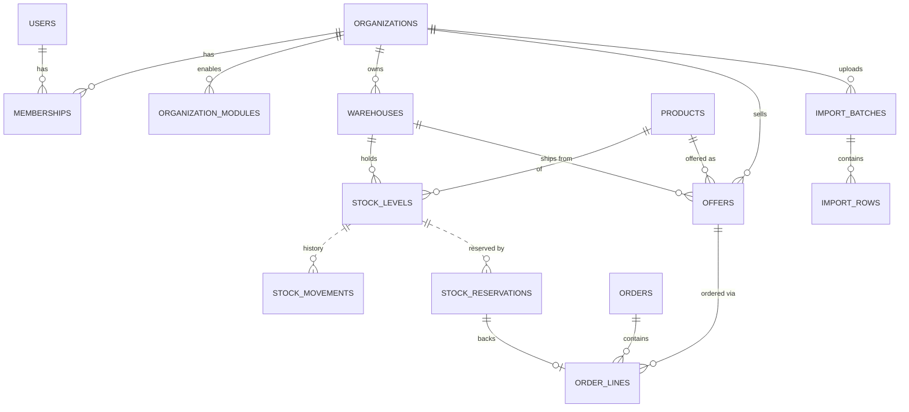

# Data model — first vertical slice

PostgreSQL 16, snake_case, one schema per module. Money = `bigint` cents. Enums = `varchar` text.
Optimistic concurrency uses PostgreSQL `xmin`. RLS column in **bold**.

| Table | Key columns | Constraints / notes |
|---|---|---|
| `identity.users` | id, email, password_hash, is_platform_admin, failed_login_count, locked_until | unique email |
| `tenancy.organizations` | id, name, legal_name, vat_id, address, is_wholesaler/is_retailer/is_repair_provider, status | unique vat_id; at least one capability |
| `tenancy.memberships` | organization_id, user_id, role | unique (org, user) |
| `tenancy.organization_modules` | (organization_id, module), enabled_by, enabled_at | removal is the only app-level DELETE |
| `catalog.products` | id, brand(_key), name, category, quality, mpn(_key), ean, compatible_models text[] | unique ean; unique (brand_key, mpn_key, quality); EAN or MPN required |
| `inventory.warehouses` | id, **organization_id**, code, is_default | unique (org, code); one default per org; AK (org, id) |
| `inventory.stock_levels` | **organization_id**, warehouse_id, product_id, on_hand, reserved | FK (org, warehouse) → cannot point at another tenant's warehouse; `0 ≤ reserved ≤ on_hand` |
| `inventory.stock_movements` | id identity, **organization_id**, quantity (≠0), on_hand_after, type, reference | append-only (no UPDATE/DELETE grant) |
| `inventory.stock_reservations` | id, **organization_id** (stock owner), reserved_by_organization_id, quantity, status, reference | created/released only via DB functions |
| `marketplace.offers` | id, **organization_id**, product_id, warehouse_id, supplier_sku(_key), price_minor, min_order_quantity, delivery_days, condition, status | unique (org, sku_key); price > 0 |
| `marketplace.offer_listings` (view) | published offers of verified B2B sellers + available stock | visible only with a tenant |
| `imports.import_batches` | id, **organization_id**, file_sha256, format, headers, mapping jsonb, summary jsonb, status | history kept; duplicate files detected by hash |
| `imports.import_rows` | **organization_id**, batch_id, row_number, raw jsonb, parsed fields, status, messages, planned actions, old price/qty | |
| `ordering.orders` | id, number (sequence), **buyer/seller_organization_id**, status, net/vat/gross minor, idempotency_key, request_hash, shipped/delivered/completed_at, inspection_ends_at | unique (buyer, idempotency_key); buyer ≠ seller; gross = net + vat |
| `ordering.order_lines` | order_id, line_number, offer_id, product snapshot, quantity, unit_price_minor, line_net_minor, reservation_id | line_net = unit × qty; RLS via parent order |
| `shipping.shipments` | id, order_id, **seller/buyer_organization_id**, carrier, status, tracking_number, parcel, declared_value_minor, insured, contains_lithium_batteries, label_pdf, handed_over_at, delivered_at | unique (carrier, tracking_number); RLS: both parties read, seller writes |
| `shipping.tracking_events` | shipment_id, external_id, occurred_at, kind, description | unique (shipment, external_id); append-only (no UPDATE grant) |
| `payments.payments` | id, order_id, **buyer/seller_organization_id**, provider, provider_payment_id, amount_minor, commission_net/vat_minor, status, paid_at, refunded_at | one live (Open/Paid) payment per order; unique provider id; RLS: buyer inserts, seller updates, both read |
| `payments.payouts` | id, payment_id (unique), **seller_organization_id**, amount_minor, provider_transfer_id | one payout per payment |
| `disputes.disputes` | id, order_id, **buyer/seller_organization_id**, reason, status, escalated/resolved_at, resolved_by, resolution | one active dispute per order; RLS: buyer opens, both read/update |
| `disputes.dispute_messages` | dispute_id, from, user_id, text, sent_at | append-only; RLS via dispute |
| `ledger.accounts` / `journal_entries` / `postings` | account per (organization?, type, currency); entry with idempotency_key; postings amount_minor ≠ 0 | written only via `ledger.post_entry`; immutable (triggers); balanced per entry |
| `notifications.email_messages` | id, source_id (outbox message), template, recipient, subject, body, status, attempts, next_attempt_at | unique (source_id, recipient) → at-least-once events never send twice; no DELETE grant |
| `infra.audit_log` | occurred_at, user_id, organization_id, entity_type, entity_id, action, changes jsonb | append-only |
| `infra.outbox_messages` | id, type, payload jsonb, occurred_at, processed_at, attempts | partial index on unprocessed |
